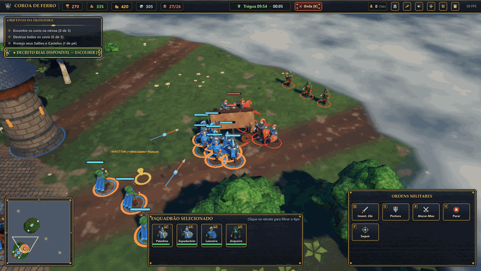
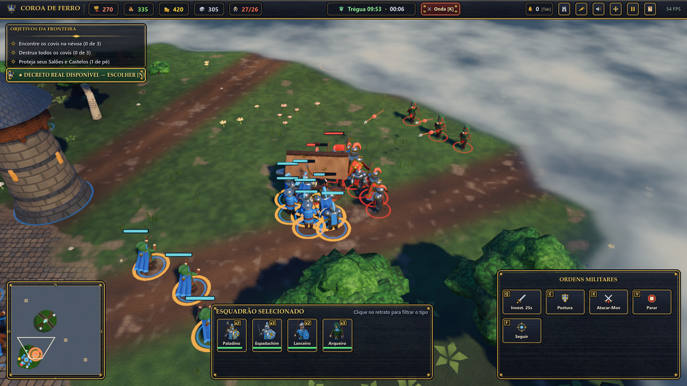
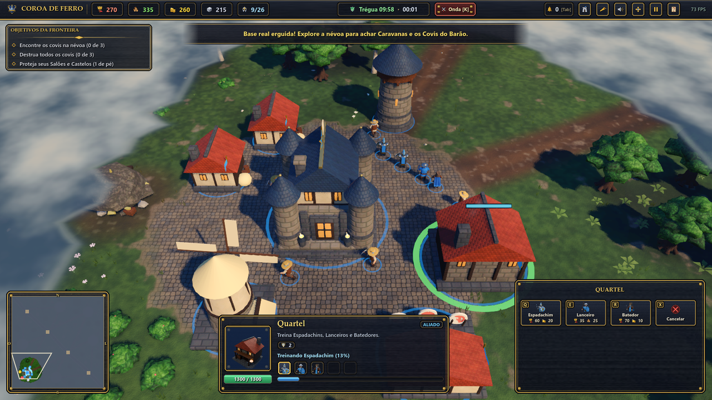
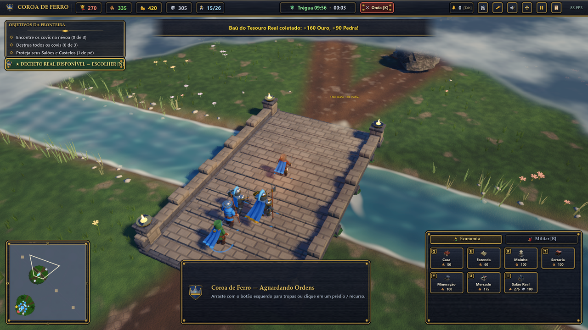
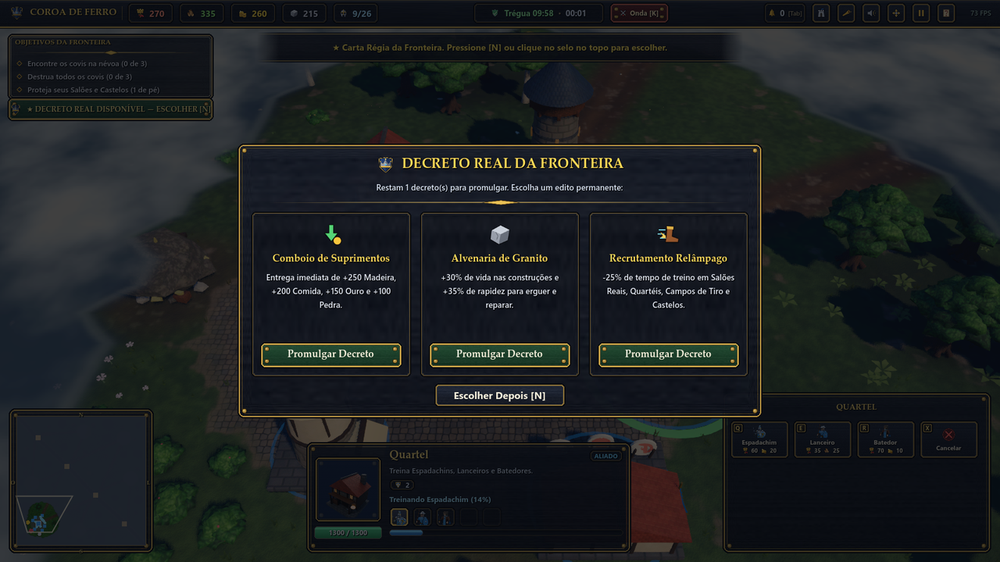

<div align="center">

# 👑 Coroa de Ferro: Crônicas da Fronteira

**RTS 3D medieval desenvolvido em Godot 4.7 (Vulkan Mobile) com pipeline 100% procedural via código**

[-478CBF?style=for-the-badge&logo=godotengine&logoColor=white)](https://godotengine.org)
[](#arquitetura-do-projeto)
[](#pipeline-100-procedural-zero-assets-prontos)
[](#performance--renderizacao-gpu-de-entrada)
[](#pipeline-100-procedural-zero-assets-prontos)
[](#testes-e2e-simulacao-e-benchmark-de-gpu)

<br/>



<br/>
<sub><i>Combate em tempo real em engine: esquadrão aliado em formação multi-fileira sob efeito de <b>Investida Real [Q]</b> enfrentando ondas e Aríetes do Barão Corvo Vermelho.</i></sub>

</div>

---

## 📌 Visão Geral

**Coroa de Ferro: Crônicas da Fronteira** é um **jogo de estratégia em tempo real (RTS) 3D base-builder** solo onde o jogador ergue uma fortaleza medieval, coleta quatro recursos, explora pontos de interesse ocultos pela névoa de guerra e sobrevive a ondas escaláveis do Barão Corvo Vermelho até destruir todos os covis inimigos além do rio.

Diferente de protótipos baseados em pacotes prontos, **todo o projeto foi construído por engenharia de código**: modelos 3D com esqueletos e animações (`Idle`, `Walk`, `Attack`, `Death`), texturas PBR 512×512, shaders GLSL customizados, molduras/ícones/retratos da interface e **51 efeitos sonoros espaciais sintetizados via DSP** — rodando a **90+ FPS em GPU de entrada (AMD Radeon RX 550)** com o renderizador *Forward Mobile*.

---

## 📸 Capturas de Tela

<table>
  <tr>
    <td width="50%" align="center">
      
      <br/><sub><b>Combate Tático & Esquadrões</b> — Formações por função, dano sincronizado ao golpe, números flutuantes e habilidades ativas (<code>[Q] Investida</code>, <code>[E] Postura</code>).</sub>
    </td>
    <td width="50%" align="center">
      
      <br/><sub><b>Construção de Base & HUD</b> — Salão Real, Moinho, Casas, Quartel com fila visual em 5 espaços, névoa volumétrica e minimapa em tempo real.</sub>
    </td>
  </tr>
  <tr>
    <td width="50%" align="center">
      
      <br/><sub><b>Rio Analítico & Exploração Viva</b> — Água com cálculo analítico por pixel, tochas com shader de chama, vegetação via GPU instancing e baús na fronteira.</sub>
    </td>
    <td width="50%" align="center">
      
      <br/><sub><b>Progressão Roguelite (Decretos Reais)</b> — Escolha entre 3 cartas permanentes (<code>[N]</code>) desbloqueadas por tempo, abates, estandartes e destruição de covis.</sub>
    </td>
  </tr>
</table>

---

## 🧠 Destaques de Engenharia

Esta seção resume as decisões arquiteturais e técnicas aplicadas no código para recrutadores e revisores técnicos:

### Performance & Renderização (GPU de Entrada)

Alvo de hardware testado: **AMD Radeon RX 550 (Vulkan Mobile, 1600×900)** — mantendo **90–101 FPS** na visão de base e **50–56 FPS** em combates densos com múltiplas partículas e névoa ligada.

- **Névoa de guerra analítica sem `depth texture` ([`fog_overlay.gdshader`](scripts/shaders/fog_overlay.gdshader), [`fog_of_war.gd`](scripts/fog_of_war.gd))**: substituição de leitura do depth buffer + 20 taps por interseção analítica raio-plano (`y = 0`) com textura dupla (`L8`) interpolada na GPU e nuvens em movimento — reduzindo o custo da camada de névoa para manter **90+ FPS**.
- **Vegetação instanciada em 5 draw calls ([`world_foliage.gd`](scripts/world_foliage.gd), [`foliage_wind.gdshader`](scripts/shaders/foliage_wind.gdshader))**: até **9.800 instâncias 3D** (grama, flores silvestres, juncos ribeirinhos, seixos e samambaias) geradas deterministicamente em **5 nós `MultiMeshInstance3D`**, herdando o albedo do terreno sob cada touceira e com redução de escala à distância no vertex shader.
- **Terreno multi-escala e rio sem serrilhado ([`terrain.gdshader`](scripts/shaders/terrain.gdshader), [`water.gdshader`](scripts/shaders/water.gdshader))**: mapa de *splat* RGBA combinando grama seca/viçosa, estradas de terra, pedregulho urbano e micro-detalhe; água com cálculo analítico por pixel de distância à margem (`river_distance`), cáusticas animadas e espuma em meandros e pilares de ponte.
- **Presets gráficos em tempo real ([`graphics_settings.gd`](scripts/graphics_settings.gd))**: alternância com `[F9]` entre *Alta*, *Equilibrada* e *Leve* com persistência em `user://graficos.cfg`, mais iluminação Golden Hour (*AgX* + LUT 1D em gradiente).

### Arquitetura de Sistemas RTS

- **Navegação híbrida A\* + Steering ([`nav_grid.gd`](scripts/nav_grid.gd), [`unit.gd`](scripts/unit.gd))**: `AStarGrid2D` com heurística Octile, suavização por linha de visão (`segment_clear`) e restrição de travessia exclusivamente sobre as 4 pontes, combinado a steering local com aceleração/desaceleração suave, desaceleração na chegada e acomodação em grupo sem tremor de animação.
- **Grades espaciais O(1) ([`game_manager.gd`](scripts/game_manager.gd))**: spatial hashing separado para obstáculos estáticos (`OBS_CELL = 8 m`) e unidades dinâmicas (`UNIT_CELL = 4 m`) usando carimbo de consulta (`_query_stamp`) sem realocações desnecessárias a cada quadro de física.
- **Formações orientadas à marcha (`assign_formation_targets`)**: distribui automaticamente infantaria pesada/aríetes na linha de frente, batedores/apoio no meio e arqueiros na retaguarda, atribuindo cada unidade ao slot disponível mais próximo para evitar cruzamento caótico de caminhos.
- **Diretor de ondas & IA de encontro ([`wave_director.gd`](scripts/wave_director.gd))**: ondas com orçamento quadrático crescente ao longo da partida, incursões econômicas periódicas, guarnições defensivas com *leash*, trompa de alerta no covil ao sofrer ataque e provocação antecipada (`[K]`).
- **Combate com peso, veterania & camada roguelite**: dano corpo-a-corpo e flechas sincronizados ao quadro médio da animação, *hit-flash* tátil, números flutuantes de dano, recompensa em ouro por abate (`BOUNTY_TABLE`), promoção automática em **3 patentes** (`★ Veterano`, `★★ Campeão`, `★★★ Lenda`) e sistema de **12 Decretos Reais** (`ROYAL_DECREES`).

### Pipeline 100% Procedural (Zero Assets Prontos)

Todos os recursos binários do repositório são reproduzíveis por scripts em [`tools/`](tools/):

| Gerador | Saída | Técnica |
|---|---|---|
| [`generate_blender_assets.py`](tools/generate_blender_assets.py) | Prédios base, ponte, árvore e mina | Blender 5.2 headless (`bmesh`) + texturas PBR 512×512 via NumPy |
| [`generate_unit_assets.py`](tools/generate_unit_assets.py) | Camponês, Espadachim, Arqueiro, Paladino | Armature humanoide + weight painting + ações NLA (`Idle`, `Walk`, `Attack`, `Death`) |
| [`generate_expansion_assets.py`](tools/generate_expansion_assets.py) | Castelo, Covil, Aríete, Lanceiro, Batedor e +7 | Expansão completa do roster usando helpers modulares |
| [`generate_terrain_textures.py`](tools/generate_terrain_textures.py) | Mapas de albedo, splat, normal e pedregulho | Baking sincronizado com [`data/map_layout.json`](data/map_layout.json) |
| [`render_hud_portraits.py`](tools/render_hud_portraits.py) | 24 retratos 3D do HUD (`assets/ui/portraits/`) | Estúdio de câmera + luz 3 pontos automatizado no Blender |
| [`generate_hud_icons.py`](tools/generate_hud_icons.py) | 33 ícones e 25 molduras/botões 9-slice | Desenho vetorial/procedural via Python + Pillow |
| [`generate_sfx_assets.py`](tools/generate_sfx_assets.py) | 51 arquivos `.wav` em 33 bancos espaciais | Síntese aditiva, Karplus-Strong, ruído filtrado, normalização LUFS e QA automático |

---

## ⚔️ Mecânicas de Gameplay

- **Base-builder & Economia (4 recursos)**: colete **Comida**, **Madeira**, **Ouro** e **Pedra** (população até 100); pontos de entrega (Moinho, Serraria, Mineração) e Mercado com preços dinâmicos.
- **Roster completo desde o início (12 construções, 7+1 unidades)**: lanceiros counteram Paladinos e Batedores; Paladinos esmagam Arqueiros; Aríetes resistem a flechas e derrubam Covis e Torres. O Barão conta com o **Capitão do Corvo** nas ondas tardias.
- **Exploração viva ([`frontier_cache.gd`](scripts/frontier_cache.gd))**: 7 pontos de interesse (*Caravana de Suprimentos*, *Baú do Tesouro Real*, *Arsenal Abandonado* com resgate de tropas e *Estandarte da Fronteira*) ocultos na névoa — os mais distantes guardados por patrulhas inimigas.
- **Habilidades Táticas & Pressão**:
  - **`[Q]` Investida Real**: grito de guerra que concede +28% velocidade e ataques mais rápidos por 6,5 s às tropas próximas.
  - **`[E]` Postura**: alterna *Manter Posição* para defender gargalos e pontes sem quebrar formação.
  - **`[R]` Sino de Defesa** (Salão Real): faz Salões, Torres e Castelos dispararem 50% mais rápido por 12 s.
  - **`[K]` Convocar Onda**: antecipa a próxima onda do Barão em 14 s em troca de **Ouro bônus imediato**.
  - **`[N]` Decretos Reais**: escolha 1 de 3 editos permanentes para moldar sua estratégia a cada partida.

---

## 🎮 Controles e Atalhos

| Ação | Comando |
|---|---|
| Selecionar unidade / Caixa de seleção | `Botão Esquerdo` (arrastar; duplo clique seleciona todos do tipo na tela) |
| Mover / Atacar / Coletar / Reparar | `Botão Direito` (com assistência de mira de 24–26 px e formações automáticas) |
| Câmera (Pan / Zoom / Órbita) | `W A S D` ou Setas (`+Shift` turbo) • `Roda` (Zoom ao cursor) • `Botão do Meio` • `Z`/`C` • `[Backspace]` Norte |
| Grupos de controle | `Ctrl + 1..5` salva • `1..5` seleciona (duplo toque foca) |
| Habilidades & Posturas | `[Q]` Investida • `[E]` Manter Posição • `[X]` Atacar-Mover • `[V]` Parar • `[F]` Seguir unidade |
| Construções & Treino | `[Q..I]` nos cartões • `[B]` alterna abas Economia/Militar • Segure `Shift` para múltiplas obras |
| Macro & Gestão | `[Tab]` Camponês ocioso • `[Espaço]` Base • `[H]` Último alerta • `[R]` Sino Defesa (no Salão) |
| Roguelite & Onda | `[N]` Escolher Decreto Real • `[K]` Provocar próxima onda (+Ouro) |
| Sistema | `[P]` Rolagem na borda • `[M]` Áudio • `[F9]` Qualidade gráfica • `[F1]` Manual • `[F10]` Pausar |

---

## 🚀 Como Executar

1. Baixe e abra o [**Godot 4.7.x**](https://godotengine.org/download) (renderizador *Mobile* / Vulkan).
2. Clone o repositório:
   ```bash
   git clone https://github.com/EduBraga7/coroa-de-ferro-rts.git
   ```
3. No Godot, clique em **Import** e selecione `project.godot`.
4. Pressione **F5** para jogar (`scenes/main.tscn`).

Opções úteis via linha de comando (após `--`):
`--autostart` • `--seed=N` • `--difficulty=facil|normal|dificil` • `--no-fog` • `--aivai` • `--graphics=alta|equilibrada|leve`

---

## 🧪 Testes E2E, Simulação e Benchmark de GPU

O projeto conta com suíte automatizada completa em GDScript:

```bash
# 1. Suíte E2E headless (19 blocos: economia, combate, ponte/A*, colisão, shaders, fog, SFX, baús, decretos, veterania e vitória/derrota)
godot --headless --path . --script tools/verify_project.gd

# 2. Simulação acelerada de partida completa (IA joga pelo jogador contra as ondas e covis)
godot --headless --path . --fixed-fps 60 --script tools/simulate_match.gd -- --minutes=70 --seed=7 --difficulty=normal

# 3. Benchmark real de GPU por camada (A/B intercalado com mediana — rodar com janela gráfica)
godot --path . --script tools/bench_render.gd -- --seed=7 --autostart --bench-ab
```

> Resultado validado após as últimas alterações: **`ALL_RTS_TESTS_PASSED`** (exit code `0`).

---

## 📁 Arquitetura do Projeto

```text
├── project.godot
├── scenes/main.tscn              # Cena raiz
├── data/map_layout.json          # Geografia única (bases, estradas, rios, florestas, minas)
├── docs/
│   ├── DESIGN.md                 # Documento de design vivo e premissas do projeto
│   └── media/                    # Screenshots e GIF demonstrativo do README
├── scripts/
│   ├── main.gd                   # Bootstrapper da partida, ambiente golden hour, pontes e encontros
│   ├── game_manager.gd           # Economia, grades espaciais, decretos roguelite, formações e UX de mouse
│   ├── unit.gd                   # Máquina de estados, steering suave, veterania, postura e animação
│   ├── building.gd               # Construções, filas de produção, defesas automáticas e vfx
│   ├── wave_director.gd          # Covis ocultos, guarnições, ondas crescentes e convocação antecipada
│   ├── frontier_cache.gd         # Caravanas, baús, arsenais e estandartes coletáveis na fronteira
│   ├── fog_of_war.gd             # Grade L8 dupla com suavização e controle de visibilidade
│   ├── nav_grid.gd               # AStarGrid2D com suavização por linha de visão e pontes
│   ├── world_foliage.gd          # 5 grupos GPU MultiMeshInstance3D (grama, flores, juncos, seixos, samambaias)
│   ├── world_look.gd             # Recursos compartilhados, shader de copa ao vento e mipmaps
│   ├── vfx_manager.gd            # Tochas, fumaça, motes solares, lascas, faíscas e poeira
│   ├── sfx_manager.gd            # Pool 2D/3D (51 WAVs), anti-repetição e Limiter no bus Master
│   ├── hud.gd                    # Interface medieval customizada (topbar, minimapa, modais e cartão de ordens)
│   ├── rts_camera.gd             # Câmera tática RTS (pan com inércia, zoom-to-cursor, órbita, follow e trauma)
│   ├── graphics_settings.gd      # Presets gráficos em tempo real [F9]
│   ├── ai_controller.gd          # Controlador de IA usado no simulador --aivai
│   ├── projectile.gd, resource_node.gd
│   └── shaders/                  # 9 arquivos GLSL (.gdshader / .gdshaderinc)
├── assets/
│   ├── models/                   # Modelos .glb + texturas PBR gerados pelo Blender
│   ├── textures/                 # Texturas multi-escala do terreno
│   ├── audio/sfx/                # 51 efeitos sonoros .wav sintetizados
│   ├── ui/                       # Ícones, molduras 9-slice e 24 retratos 3D
│   └── blender/                  # Fontes .blend
├── tools/                        # Geradores Python (Blender/NumPy/Pillow) + E2E + Simulador + Benchmark
└── .claude/skills/               # 79 skills gamedev (Apache-2.0)
```

---

## 📜 Licença

Código e assets procedurais desenvolvidos para o portfólio de **Coroa de Ferro: Crônicas da Fronteira** — defina a licença desejada para distribuição pública. As skills em [`.claude/skills/`](.claude/skills/) mantêm a licença Apache-2.0 original (`LICENSE-awesome-gamedev-agent-skills`).
